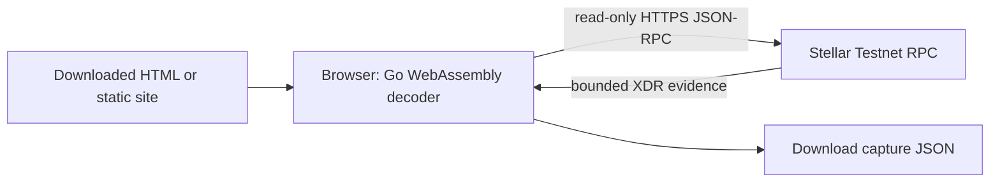

# Browser edition: no server or account

Download `web/published/FleetWatch.html` from the repository and open the saved
file in a current browser with WebAssembly and DecompressionStream support. The
file contains the Go runtime, compiled decoder, styles and license notices; it
downloads no executable dependency. Internet access to the fixed Testnet RPC is
needed. The same file can be served as `index.html` on a static host.

The page starts with the two actual FleetWatch Testnet demonstration contracts
and reads them automatically. Replace addresses to inspect another explicit
watchlist. Read-only requests need no wallet, key, account or Linux machine.
Testnet can reset or archive entries; missing data never proves deletion.



This is a foreground **current-state viewer**. It refreshes every 60 seconds
while visible, or on request. Closing the page stops it. Browsers can suspend
tabs; polling misses intermediate changes. There is no historical ingestion,
durable journal, unattended alarm, approval verdict or webhook in this edition.
The native follower remains available separately; its cursor/evidence is untouched.

The existing XDR adapter retains schema-v2 raw key/data evidence, digests, tag hex
and claimed ledger. External references require multiple calls, so remain PARTIAL
with UNKNOWN consistency even when heights match. Authentication is UNVERIFIED,
history UNKNOWN and verdict UNDETERMINED. No capture is stripped into v1 compare.

Observations live in memory; download JSON to keep evidence. Editing the watchlist
clears old values. Failed refreshes label displayed values stale. There is no
telemetry, remote persistence or credential collection. CSP allows only the fixed
Testnet endpoint; Fetch omits credentials and rejects redirects. The browser owns
TLS/CORS. Managed browsers may prohibit local HTML or WebAssembly, requiring a
permitted static host under that organization's policy.

Build using the pinned Go compiler:

```sh
python3 scripts/package-browser.py dist/browser-new
```

Output must be a new directory. It contains HTML, BUILD.json, licenses and hashes.
Metadata records source SHA and dirty state. Publication records a clean source
commit in a later distribution commit, avoiding self-referential build identity.

For deterministic Chromium integration tests, install Playwright 1.62.1, supply
Chromium (`CHROMIUM_PATH` if different from `/usr/bin/chromium`), then run:

```sh
node scripts/check-browser.cjs dist/browser-new/FleetWatch.html
```

Tests use mock RPC fixtures and check XDR, assurance, raw downloads, Fetch options,
malformed/missing entries, invalid addresses/network, stale labels and redirects.
CI cross-builds WASM; local browser tests do not establish remote CI success.
See [actual validation](research/2026-10-27-browser-validation.md).
