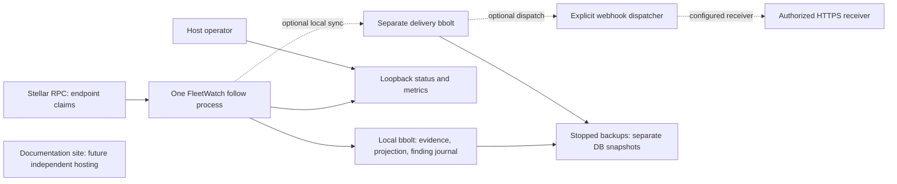

# Portable Linux pilot deployment

The chosen Phase 9 target is a portable Linux deployment, with no new paid
resources. This package supports one read-only follower on one Linux amd64 host,
one local persistent disk and loopback health/metrics. It does not provision a
host, publish a release or claim production validation. There is no mandatory
frontend, contract deployment or separate SQL service.



This deliberately uses the current synchronous local bbolt design for an
experimental single-host pilot. The roadmap's shared-writer Postgres backend,
continuous retention/archive policy and production delivery are not implemented
by adding a hosting manifest. Keep the database on the same host as the worker;
network filesystems, ephemeral disks, multiple replicas and overlapping writers
are unsupported. Documentation hosting will be independent of the observer.

## Prepare and install a local candidate

From the repository, activate Go from `.go-version`, then:

```sh
mkdir -p dist
./scripts/package-linux.sh dist/linux-candidate
```

The candidate contains a static Linux amd64 binary, user installer, systemd
template, guides, license/linked-module notices, per-file SHA256SUMS and BUILD.json with the source
commit, dirty-tree flag and compiler. A dirty candidate is explicitly labelled;
it is not a release artifact. Other platforms are not validated by this package.
On the destination, install OS CA certificates plus Bash, Python 3, coreutils
and tar. TLS verification remains enabled. Verify the archive checksum from your
trusted handoff, extract it, then install to a **new** user-owned absolute path:

```sh
tar -xzf fleetwatch-linux-amd64.tar.gz
fleetwatch-linux-amd64/bin/install-user.sh \
  "$HOME/fleetwatch-pilot" /path/to/actual-asserted-baseline.json \
  https://soroban-testnet.stellar.org
```

The installer checks file hashes, validates configuration/baseline using the
packaged binary, and writes a fresh installation atomically without overwriting
an existing directory. It creates no signing key and performs no RPC call. Paths
containing whitespace or systemd metacharacters are rejected. Review/edit
`etc/fleetwatch/follow.json` before running. State and baseline are separate;
paths remain valid after moving the staged installation into its destination.

Run the installed offline host preflight before starting the binary:

```sh
"$HOME/fleetwatch-pilot/bin/host-check.py" "$HOME/fleetwatch-pilot"
```

It prints a JSON report and exits 1 for failed requirements, 0 when only warnings
remain. It checks Linux amd64, required tools, CA path availability, offline
configuration/baseline validation, private state-directory ownership/permissions,
free filesystem space (at least 1 GiB by default), static unit syntax and user
manager availability. `--min-free-bytes N` sets the reviewed free-space threshold;
this is a point-in-time filesystem check, not a storage reservation or retention
estimate. It makes no RPC call, opens no state database and starts no listener or
service. It suppresses raw child-process output and does not print proxy values.

A successful report still carries `production_validated: false`. CA path checks
do not establish certificate validity or the Go service's TLS connectivity.
Filesystem suitability, source history availability, memory/cgroup enforcement,
the unit's actual hardening, backup destination, readiness and logout/reboot
behavior require checks on the chosen host. Missing systemd support is a warning
for foreground use; resolve it before relying on the user unit.

Then run the binary in the foreground and check the local status:

```sh
"$HOME/fleetwatch-pilot/bin/fleetwatch" follow \
  --config "$HOME/fleetwatch-pilot/etc/fleetwatch/follow.json"
# In another terminal on that host:
curl --fail http://127.0.0.1:9789/readyz
curl --fail http://127.0.0.1:9789/metrics
```

Readiness is qualified ingestion readiness, not an approved/no-risk verdict.
Use a source-retained baseline and a target host with sufficient disk space.
The new runtime can advance past sixteen total ledgers; the per-batch bound stays
sixteen, with hard retained-data budgets and no automatic evidence deletion.
The 64-MiB default is for a short pilot: the observed Testnet run retained about
5.7 MB for seventeen ledgers. Storage can fill quickly; this default is not an
unattended production retention plan.
See [FOLLOW.md](FOLLOW.md) for exact limits and failure behavior.

## Run under the user's systemd manager

No unit is enabled or started by the installer. After the foreground checks:

The default `fleetwatch.service` follows without automatic outbox sync. The
optional `fleetwatch-sync.service` adds paired delivery-state/stream flags for
local queue sync only, with its outbox in the writable state directory. Review
its absolute paths and stable stream, and choose one unit; do not run both.
To use the alternative, substitute `fleetwatch-sync.service` in the commands
below, including static verification and later maintenance commands. No webhook
dispatch or receiver is enabled by either unit. See [FOLLOW_DELIVERY.md](FOLLOW_DELIVERY.md)
for sync deadlines, readiness, lock contention and recovery semantics.

The separate optional `fleetwatch-delivery.service` can dispatch alongside the
chosen follower after explicit receiver/key configuration. It requires its own
private environment file and is not started or enabled by installation. See
[DELIVERY_LOOP.md](DELIVERY_LOOP.md) before starting anything that sends messages.

```sh
systemd-analyze --user verify "$HOME/fleetwatch-pilot/systemd/fleetwatch.service"
systemctl --user link "$HOME/fleetwatch-pilot/systemd/fleetwatch.service"
systemctl --user daemon-reload
systemctl --user start fleetwatch.service
systemctl --user status fleetwatch.service
journalctl --user -u fleetwatch.service --since '10 minutes ago'
```

Enable boot/login persistence only after host review. Running while logged out
may require administrator-approved user lingering. The unit runs as the existing
user, with no new account or root service. It uses a restrictive umask, read-only
system/home views with a specific state write path, no privilege elevation, a
one-GiB memory limit and bounded logging rate. Hardening depends on the target
host's systemd/user-namespace/cgroup support. Verify it there rather than treating
a successful binary smoke as a completed hosted installation.

Configuration, source/evidence, state/output failures and capacity exits are
excluded from automatic restart, so systemd does not hide them in a restart loop.
Unexpected process failure can restart; full retained-evidence validation still
runs. `systemctl active` alone is not readiness: use `/readyz` and its explicit
assurance. Confirm that the metrics timestamp advances; alert on not-ready,
growing lag, gap episodes, pending findings, retention utilization and host disk.
No uptime or throughput SLA is promised from the local pilot.

The optional unit environment file is
`$HOME/.config/fleetwatch/environment`. A systemd user manager may not inherit
your interactive proxy settings. If the host requires a proxy/CA selector, add
the needed nonsecret proxy URLs and SSL_CERT_FILE there without printing secret
values, and restrict permissions to 0600. Preserve platform-injected credentials
through their supported route; never paste private keys into config or disable
TLS/proxy controls. No webhook secret is required by this observer.

## Maintenance and incidents

Stop before offline inspection, backup or restore:

```sh
systemctl --user stop fleetwatch.service
"$HOME/fleetwatch-pilot/bin/fleetwatch" follow-inspect \
  --config "$HOME/fleetwatch-pilot/etc/fleetwatch/follow.json" --limit 20
"$HOME/fleetwatch-pilot/bin/fleetwatch" backup \
  --state "$HOME/fleetwatch-pilot/var/lib/fleetwatch/follow.db" \
  --output /separate/existing/storage/NEW_BACKUP.db
```

Copy the baseline/configuration and a checksum with the backup. Test restoration
to a separate stopped pilot before relying on it. Keep the prior database and
validate retained evidence before restart. Retention budgets count logical
payload, not total physical disk; the existing backup's 512-MiB physical cap can
stop a backup. Watch actual filesystem usage and backup failures.
For a stopped follow store, `follow-compact --config FILE --output NEW_DB`
can reclaim unused physical pages in a separate validated file while preserving
operational counters. See [COMPACTION.md](COMPACTION.md). Review/inspect a separate
configuration before switching paths; compaction does not raise logical budgets.

When capacity is reached, stop, preserve evidence and plan an archive/backend
transition. This version does not prune old ledgers or remove journal findings.
`follow-archive --config FILE --output NEW_FILE` can preserve a compressed,
independently replayable evidence copy; `verify-follow-archive --input FILE`
checks it offline. See [ARCHIVES.md](ARCHIVES.md). This does not free capacity
or replace the database backup needed for restart.
Archive recovery can rebuild a separate new database using a trusted receipt
checksum; review the archive guide's baseline extraction, reset-counter warning
and separate configuration checks. It does not overwrite live state or start
the service.
Do not delete pending evidence or relabel a new current-state snapshot as a
continuous historical baseline to get past the limit. Increasing a reviewed
budget can extend a pilot; it does not solve production retention.

Source outages keep readiness false and retry without skipping. Wrong network,
regressing head, bad metadata, preimage conflict or corrupt retained state stops
for inspection. Correct the cause; do not reset the cursor or disable checks.
Upgrades require stopping, retaining a backup, staging a separately verified
binary and smoke-checking the unchanged config/state. There is no automatic
schema migration or downgrade guarantee.

The [follow delivery bridge](FOLLOW_DELIVERY.md) can import validated findings
into a separate durable outbox, either manually while stopped or automatically
with paired opt-in follower flags. It does not configure webhook dispatch,
a receiver or native journal deletion.
Production receiver/proxy routing, shared SQL storage, authentication and fully
hosted end-to-end operations remain open Phase 9 work. The Dripwave skill's
production hosting gate is not claimed complete merely because these files exist.
